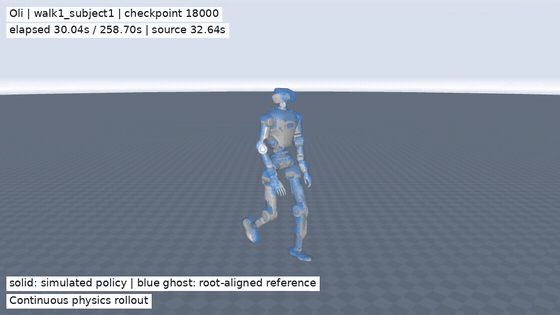

# 基于 Isaac Lab 3 的 LimX Oli SuperMimic（kit-less，MuJoCo-Warp）

[English](README.md) | **简体中文**

这是基于 [zita-ch/supermimic_vibed](https://github.com/zita-ch/supermimic_vibed) 的 **Oli 非官方适配版本**。原仓库由 Chong Zhang 实现，是对 *SuperMimic: Scaling Humanoid Whole-Body Control with One Differentiable World Model* 的复现，也是我们的代码参考与开发基础。本仓库在此基础上增加 **LimX Oli HU_D04_01（31 DoF）**、动作数据处理及完整推理视频导出，并保留 G1 支持。

Oli 适配：**刘天行 Tianxing Liu**。上游实现：**Chong Zhang（ETH Zurich）**。代码许可证：[MIT](LICENSE)。

> **一个 Oli 策略跟踪 40 个 LAFAN1 动作。** 在选定的第 **18,000** 次 checkpoint 上，原始全动作集评估的归一化回报为 **0.6783**，**36/40 个动作未触发终止条件**。该 checkpoint 对应的训练用时约为 **2.20 小时，使用单张 RTX 4090**。

[](results/oli_walk1_subject1_full.mp4)

**[观看或下载 Oli 完整视频——4 分 19 秒，MP4](results/oli_walk1_subject1_full.mp4)**

*演示动作是 `walk1_subject1`，它是该次原始评估中得分最高的成功动作（0.8638）。GIF 展示其中 12 秒；MP4 保留跳过开头 2.60 秒 T-pose 后的完整推理过程。实心机器人为策略控制的物理仿真，半透明蓝色机器人为参考动作，其根节点 XY 与仿真机器人对齐，用于比较姿态。本次演示推理未触发跟踪终止阈值。*

版本变化见 [CHANGELOG.md](CHANGELOG.md)。评估记录见[原始评估 JSON](results/ckpt_018000_eval.json)和[完整导出汇总](results/oli_v5_export_summary.json)。保留的 [MILESTONES.md](MILESTONES.md) 记录的是上游 G1 实验。

## 目录结构

| 路径 | 内容 |
|---|---|
| `IsaacLab/` | 不纳入版本管理的运行时，由 `tools/setup.sh` 固定到 `46d6cc3` |
| `docker/` | 上游 kit-less 镜像及容器启动脚本 |
| `supermimic/` | World model、策略、训练、评估和机器人配置 |
| `tools/oli_*.py`、`tools/oli_ik_config*.json` | Oli 模型转换、动作重定向、标定、接地与诊断 |
| `tools/record_full_motion.py`、`tools/render_full_motion.py` | 批量并行推理与逐动作完整视频导出 |
| `configs/` | 选定 v5 动作的推理起始帧 |
| `results/` | Oli 演示、评估数据，以及保留的上游 G1 示例图片 |
| `data/`、`logs/` | 不纳入版本管理的模型、动作、checkpoint 和训练日志 |

## 环境准备

**要求：** Linux、NVIDIA GPU、Isaac Lab kit-less 运行时；视频导出需要 FFmpeg。本次 Oli 实验使用 24 GB RTX 4090、Isaac Lab commit [`46d6cc3`](https://github.com/isaac-sim/IsaacLab/commit/46d6cc3d7b115906fad12efd372fbf69f4e3d3ed)、PyTorch `2.11.0+cu126`、MuJoCo/MuJoCo-Warp `3.15.0` 和 Warp `1.17.0`。动作重定向使用独立的 [GMR](https://github.com/YanjieZe/GMR) 环境。

物理仿真采用 Newton + MuJoCo-Warp，控制频率 **50 Hz**，每个控制步包含 **4 个 5 ms 物理子步**，无需启动 Isaac Sim GUI。

### 1. Isaac Lab 运行时

在安装了 Docker 和 NVIDIA Container Toolkit 的主机上执行：

```bash
git clone https://github.com/liuskywalkerjskd/supermimic_oli.git
cd supermimic_oli
tools/setup.sh
docker/run_container.sh 0 128g
```

仓库会挂载到 `supermimic` 容器内的 `/workspace/supermimic`。`tools/setup.sh` 固定 Isaac Lab 版本，并构建上游 kit-less 镜像。如果已有相同版本的运行时，也可直接执行相应 Python 命令。

### 2. Oli 机器人模型

在主机下载官方模型，再使用运行时生成串联 MJCF 和 USD：

```bash
mkdir -p data/vendor
git clone --depth 1 https://github.com/limxdynamics/humanoid-description.git \
  data/vendor/humanoid-description
docker exec supermimic python tools/oli_build_mjcf.py \
  --desc data/vendor/humanoid-description/HU_D04_description
docker exec -e SM_ROBOT=oli supermimic python tools/mjcf_to_usd.py
```

预期生成 `data/oli_description/oli_31dof.xml`、其 `meshes/` 目录和 `data/oli_usd/oli_31dof/oli_31dof.usda`。串联模型移除踝部和腰部的闭环推杆，与 LimX 的训练表示保持一致。模型资产保留其原始许可证。

### 3. LAFAN1 → Oli 动作

按照 [Ubisoft La Forge](https://github.com/ubisoft/ubisoft-laforge-animation-dataset) 的条款取得 LAFAN1 BVH 文件，将指定的 40 个动作放入 `data/lafan1_bvh/`。参照 [GMR 安装说明](https://github.com/YanjieZe/GMR) 准备独立环境。本次重定向使用 GMR commit `25f56db79ac411258b377b6d4ccba0c8ff3372ac`。

在仓库根目录激活该 GMR 环境后执行：

```bash
git clone https://github.com/YanjieZe/GMR.git data/vendor/GMR
git -C data/vendor/GMR checkout 25f56db79ac411258b377b6d4ccba0c8ff3372ac
python tools/oli_retarget_lafan1.py \
  --gmr data/vendor/GMR --bvh_dir data/lafan1_bvh \
  --ik_cfg tools/oli_ik_config_v5.json --out data/lafan1_oli_v5_raw -j 8
SM_ROBOT=oli python tools/oli_ground_motion.py \
  --src data/lafan1_oli_v5_raw --dst data/lafan1_oli_v5 -j 8
```

CSV 为 30 Hz，每行包含根节点位置、**xyzw** 顺序的根节点四元数，以及 **31 个关节角**；动作库会重采样至 50 Hz。40 个动作名称列在 `tools/oli_retarget_lafan1.py` 中。本仓库不重新分发 BVH、重定向 CSV 或机器人 mesh。

## 使用方法

### 训练与评估

准备好动作后，在主机执行：

```bash
docker exec -e SM_ROBOT=oli supermimic python tools/test_env.py --motion_dir data/lafan1_oli_v5
docker exec -e SM_ROBOT=oli supermimic python supermimic/train.py \
  --motion_dir data/lafan1_oli_v5 --log_dir logs/oli_lafan1_v5 \
  --num_envs 4096 --iterations 320000 --amp bf16 --seed 0
```

在另一个终端中自动评估新生成的 checkpoint：

```bash
docker exec -e SM_ROBOT=oli supermimic python supermimic/evaluate.py \
  --run_dir logs/oli_lafan1_v5 --motion_dir data/lafan1_oli_v5 --watch
```

每 2,000 次迭代保存一个 checkpoint。下面示例中的 checkpoint 需要由训练生成，仓库不包含预训练权重。配合 G1 模型和动作设置 `SM_ROBOT=g1`，可使用保留的上游配置。`tools/swanlab_sync.py` 可将 CSV 日志同步到 SwanLab，需要安装对应 SDK 并使用自己的账号登录。

### 跳过开头 T-pose 的完整推理

v5 配置中的起始帧以 **50 Hz 重采样后的参考序列**为基准。录制器为所选动作创建独立环境并行推理，分别从配置的参考姿态与速度初始化，一直记录到源动作末帧。即使触发终止阈值，也会继续物理仿真并在视频中标注。

```bash
docker exec -e SM_ROBOT=oli supermimic python tools/record_full_motion.py \
  --checkpoint logs/oli_lafan1_v5/ckpt_018000.pt \
  --motion-dir data/lafan1_oli_v5 \
  --selection configs/oli_v5_export_best4.json --out-dir logs/oli_full

docker exec -e SM_ROBOT=oli -e MUJOCO_GL=egl supermimic \
  python tools/render_full_motion.py \
  --traj logs/oli_full/walk1_subject1.npz \
  --meta logs/oli_full/walk1_subject1.json \
  --out logs/oli_full/walk1_subject1.mp4
```

将 selection 换成 `configs/oli_v5_export_success36.json`，可录制该次原始评估中通过的全部 36 个动作，再逐个渲染生成的 NPZ。这些起始帧仅对应 v5 数据集。其中两个动作在双臂仍伸展时就已开始腿部运动，因此保留这部分动作。输出视频采用 H.264、960×540、25 fps，并包含最终状态。

## 实验结果

下表对应 **v5，第 18,000 次 checkpoint**，记录日期为 2026-10-23。

| 指标 | 结果 |
|---|---:|
| 原始评估：全部 40 个动作的归一化回报 | 0.6783 |
| 原始评估：未触发终止条件的动作 | 36 / 40 |
| 演示行走动作：原始归一化回报 | 0.8638 |
| 从 T-pose 之后重新初始化的完整导出 | 36 个动作 |
| 完整导出中未触发终止阈值的动作 | 35 / 36 |

原始评估从每个动作的原始首帧开始，视频导出则从较晚的参考状态开始，两组成功数对应不同的评估条件。`walk3_subject4` 在导出推理的 **21.32 秒**触发阈值，仍保留了完整轨迹。36 个本地视频均通过完整解码、时长和末帧检查；本仓库仅附带选定的行走演示。

## 实现对应关系

| 模块 | 文件 |
|---|---|
| 机器人选择，Oli/G1 关节、执行器与跟踪刚体 | `supermimic/robot.py`、`robot_oli.py`、`robot_g1.py` |
| 动作重采样与可微运动学 | `supermimic/motion.py`、`kinematics.py` |
| 观测、跟踪奖励、终止条件与仿真 | `supermimic/mdp.py`、`env.py` |
| World model、策略、critic、replay 与学习 | `supermimic/networks.py`、`buffer.py`、`train.py` |
| 原始全动作集评估 | `supermimic/evaluate.py` |
| 连续轨迹录制与视频渲染 | `tools/record_full_motion.py`、`render_full_motion.py` |

## 实现选择与限制

- Oli 使用 31 个关节和串联训练模型，上游 G1 为 29 个关节，两者分数不能直接作为同一基准比较。
- 沿用关闭 self-collision 的设置。接地处理通过调整参考根节点高度减少穿地，但不能保证每个重定向动作都满足动力学约束。
- 视频中的参考机器人进行了根节点 XY 对齐，展示姿态跟踪，不展示绝对位置漂移。
- 本项目为仿真研究代码，尚未验证实体机器人部署。

## 致谢与第三方许可

- **主要代码参考：** [zita-ch/supermimic_vibed](https://github.com/zita-ch/supermimic_vibed)，Chong Zhang / ETH Zurich，MIT。基础 commit 为 `a1508d42c9d1699a52e8233ab16d08c488441ab9`，保留上游历史和版权声明。
- **方法：** [SuperMimic](https://arxiv.org/abs/2610.28480)。本仓库是非官方适配，与论文作者无隶属关系。
- **Oli 模型和执行器参数参考：** [LimX humanoid-description](https://github.com/limxdynamics/humanoid-description) 与 [humanoid-rl-isaaclab](https://github.com/limxdynamics/humanoid-rl-isaaclab)，Apache-2.0。
- **动作重定向：** [GMR](https://github.com/YanjieZe/GMR)；可选的 roll 标定使用 [LimX GMR 工具](https://github.com/limxdynamics/GMR)。
- **仿真：** [Isaac Lab](https://github.com/isaac-sim/IsaacLab)、[Newton](https://github.com/newton-physics/newton) 和 [MuJoCo-Warp](https://github.com/google-deepmind/mujoco_warp)。
- **动作数据：** Ubisoft La Forge 的 LAFAN1，CC BY-NC-ND 4.0；上游 G1 重定向数据来自 [lvhaidong/LAFAN1_Retargeting_Dataset](https://huggingface.co/datasets/lvhaidong/LAFAN1_Retargeting_Dataset)。数据与资产保留各自许可；说明性演示媒体不属于代码 MIT 许可证的授权范围。

## 许可证

代码采用 [MIT License](LICENSE)，保留上游声明并注明 Oli 新增内容。第三方数据、资产和演示媒体的许可见上述说明。
